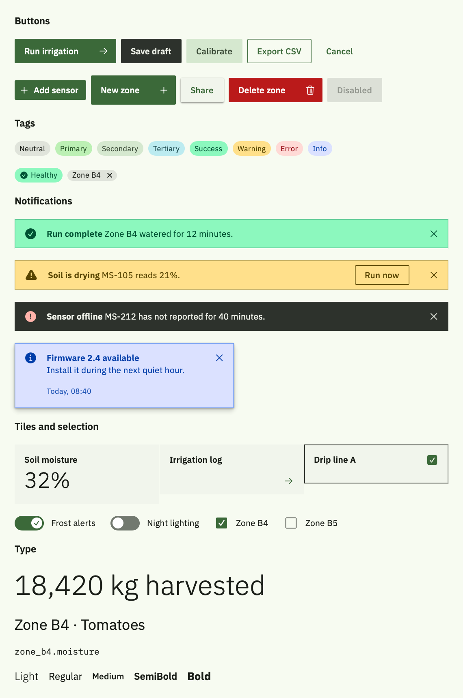

# Leafy design system

Leafy is a design system built on Material 3, IBM Carbon's type, sizing and structure, and calm Zen interface sounds. This repository holds it for three platforms, all built from one export of the design system:

| Platform | Folder | What you get |
| --- | --- | --- |
| **Web** | [`leafy-web`](leafy-web) | CSS tokens and styles for all 41 components, IBM Plex, and the React components (ES module or `<script>` tag, with TypeScript types) |
| **Android** | [`leafy-native/android/leafy`](leafy-native/android/leafy) | A Jetpack Compose theme and 9 Leafy components on Material 3 |
| **iOS** | [`leafy-native/ios/LeafyDesign`](leafy-native/ios/LeafyDesign) | A SwiftUI package with the same theme and 9 components |

Every platform shares these, generated from the same tokens:
- colour roles
- type, spacing, sizes and corners
- the sound map

<picture>
  <source media="(prefers-color-scheme: dark)" srcset="leafy-native/docs/swiftui-dark.png">
  
</picture>

## Releases

Each [release](https://github.com/S3nc0/leafy-design-system/releases) has one download per platform, so you don't need the whole repository:

| File | What it is |
| --- | --- |
| `leafy-web-<version>.tgz` | The web package, ready for `npm install` |
| `leafy-android-<version>.zip` | The Compose library module, to unzip into your project as `leafy` |
| `LeafyDesign-ios-<version>.zip` | The Swift package, to add in Xcode with Add Local… |

Each download includes `LICENSE` and `LICENSES.md`.

To make a new release, follow these steps:
1. Raise `version` in `leafy-web/package.json` and commit.
2. Run `node tools/release.mjs`, which builds the three files into `dist/`.
3. Attach the files to a GitHub release tagged `v<version>`.

## What's in this repository

```
design-system/                 the Leafy design system, exported from claude.ai (the source for everything else)
├── tokens.json                colour, type, spacing, size, shape, elevation, grid and sound tokens
├── zen-cues.json              the 78 uisfx Zen cues (names, categories, loops)
├── guidelines.md              how to use colour, type, shape, motion, sound and the components
└── components/                the React components (bundle.js, bundle.css, index.d.ts) and one doc per component
tools/
├── generate.mjs               builds leafy-web and the native token files from design-system/
├── release.mjs                builds the per-platform release downloads into dist/
└── woff-to-sfnt.cjs           turns IBM's WOFF fonts into the TTFs the native apps bundle
leafy-web/                     the web package
├── css/                       leafy.css (everything), or fonts.css, icons.css, tokens.css and components.css
├── fonts/                     IBM Plex Sans and Mono (WOFF2)
├── js/                        leafy.js (ES module), leafy.global.js (script tag), leafy.d.ts (types)
├── examples/                  a React dashboard, an ES module page and an HTML-and-CSS-only page
└── package.json
leafy-native/
├── android/leafy/             Android library module (Jetpack Compose + Material 3)
├── ios/LeafyDesign/           Swift package (SwiftUI, iOS 16+, macOS 13+)
└── docs/                      reference renders of the SwiftUI components
LICENSE                        Apache License 2.0, for Leafy itself
LICENSES.md                    which licence covers what, including the fonts, sounds and icons
```

## Web

The web package is the design system itself: all 41 components, styled with the same CSS and built from the same React code as the design system on claude.ai.

**1. Add it.** Pick the route that fits your site:

- **With a bundler (Vite, Next.js, webpack).** Install the package file from a release. Leafy isn't on the npm registry.

  ```bash
  npm install https://github.com/S3nc0/leafy-design-system/releases/download/v0.1.0/leafy-web-0.1.0.tgz
  ```

  To work from a copy of the folder instead, run `npm install ./leafy-web`.

  ```js
  import 'leafy-web/leafy.css';
  import { Button, Notification, DataTable, sound } from 'leafy-web';
  ```

  It needs React 18 or later as a peer dependency, and TypeScript picks up the types from `js/leafy.d.ts`.

- **Without a build step.** Link the stylesheet, React and the classic script, which sets `window.Leafy`:

  ```html
  <link rel="stylesheet" href="leafy-web/css/leafy.css">
  <script crossorigin src="https://unpkg.com/react@18.3.1/umd/react.production.min.js"></script>
  <script crossorigin src="https://unpkg.com/react-dom@18.3.1/umd/react-dom.production.min.js"></script>
  <script src="leafy-web/js/leafy.global.js"></script>
  ```

- **HTML and CSS only (any framework, or none).** Link `leafy.css` and write the markup with Leafy's `lf-` classes. Form controls are native inputs, so they work without scripts. [`examples/html-only.html`](leafy-web/examples/html-only.html) shows the markup the React components produce, ready to copy.

**2. Pick a theme.** With no `data-theme`, pages follow the system's dark mode and increased-contrast settings. To fix one, set it on `<html>`:

```html
<html data-theme="dark">  <!-- light, dark, light-hc or dark-hc -->
```

You can also put `data-theme` on any element, to theme just that part of a page.

**3. Use it.**

```jsx
<Notification kind="warning" title="Soil is drying">MS-105 reads 21%, below the 25% target.</Notification>
<Button icon="water_drop" onClick={run}>Run irrigation</Button>
<Switch label="Frost alerts" checked={frost} onChange={(e) => setFrost(e.target.checked)} />
```

```css
.panel { background: var(--layer-01); padding: var(--space-4); border-radius: var(--shape-corner-small); }
```

Text styles are classes too, such as `class="lf-title-small"` or `lf-body-medium`.

Each component's props, variants and sounds are documented in [`design-system/components`](design-system/components). [`design-system/guidelines.md`](design-system/guidelines.md) covers when to use what: colour roles, type, layers, spacing, motion, sound and accessibility.

**4. Fonts and icons.**
- **Fonts:** IBM Plex is served from the package (`fonts.css`), and browsers download only the weights a page uses.
- **Icons:** the icon font, Material Symbols Sharp, loads from Google Fonts (`icons.css`). To self-host it, swap that import for your own `@font-face`.

**5. Sound.** The components play the Zen sounds themselves. The uisfx runtime inside `leafy.js` synthesizes each sound in the browser, so there are no audio files to serve. Play outcomes with `sound.play('success')`. People's on/off and volume choice is saved in `localStorage` under `leafy:sound`, and `<SoundSettings />` gives them the controls.

> [!NOTE]
> All three examples were checked in a browser: Light, Dark and high contrast, a 375px phone width, and the sound events, with no console errors. The ES module build was also run in Node with React 18.3.1. React 19 hasn't been tested.

## Native apps

Each native platform gets:

- **Theme:** all four themes (Light, Dark, Light high contrast, Dark high contrast). That covers every Material 3 colour role plus Leafy's status, layer, field, border, focus and link roles.
- **Type:** the 15 Material 3 styles in IBM Plex, plus two code styles. IBM Plex Sans and Mono are bundled.
- **Tokens:** spacing, control sizes, corners, opacities, elevation, grid and breakpoints, and Carbon's motion curves.
- **Sound:** a player for the Zen pack's 78 sounds, with the same component sounds as the web. It saves each person's on/off and volume choice and plays at most 4 sounds at once.
- **Components:** the pieces Material 3 and SwiftUI don't already provide (see [Components](#components)).

### Android: Jetpack Compose

**1. Add the module.** Download `leafy-android-<version>.zip` from the [latest release](https://github.com/S3nc0/leafy-design-system/releases/latest) and unzip it into your project as a module folder named `leafy`. You can also copy [`leafy-native/android/leafy`](leafy-native/android/leafy) from this repository. Then:

```kotlin
// settings.gradle.kts
include(":leafy")

// app/build.gradle.kts
dependencies { implementation(project(":leafy")) }
```

It needs Kotlin 2.0+, the Compose compiler plugin and Android Gradle Plugin 8. It targets the Compose BOM `2024.12.01` (Material 3 1.3). Change that in `android/leafy/build.gradle.kts` to match your app's BOM.

**2. Wrap your UI in `LeafyTheme`.**

```kotlin
setContent {
    LeafyTheme {
        GreenhouseApp()
    }
}
```

It follows dark mode. On Android 14+ it also follows the system contrast setting, where medium or high picks the high-contrast themes. You can force either with `darkTheme` and `highContrast`.

**3. Use it.**
- **Material 3 components** inside `LeafyTheme` already use Leafy's colours, type and corners.
- **Leafy components** cover the rest:

```kotlin
LeafyButton("Run irrigation", onClick = ::run, icon = LeafyIcons.ArrowForward)
LeafyNotification(LeafyNotificationKind.Warning, "Soil is drying", message = "MS-105 reads 21%.")
Text("Zone B4", style = Leafy.typography.titleSmall, color = Leafy.colors.onSurfaceVariant)
Spacer(Modifier.height(LeafySpacing.space4))
```

**4. Fonts.** IBM Plex is bundled in the module's `res/font` and is the default, so there's nothing to set up:
- Sans in Light, Regular, Medium, SemiBold and Bold.
- Mono in Regular and SemiBold.

You can use the families directly as `LeafyPlex.Sans` and `LeafyPlex.Mono`. If an app must use the device's fonts instead, pass `LeafyTheme(fonts = LeafyFonts.System)`. Either way, list IBM Plex in your app's open-source notices. Its licence text is in `android/leafy/IBM-Plex-OFL.txt`.

> [!NOTE]
> The Compose module is written for Compose with Material 3 1.3 but **hasn't been compiled yet**. Build it once in Android Studio, then open the previews in `LeafyGallery.kt` to check every component in three themes.

### iOS: SwiftUI

**1. Add the package.**
1. Download `LeafyDesign-ios-<version>.zip` from the [latest release](https://github.com/S3nc0/leafy-design-system/releases/latest) and unzip it. You can also clone this repository and use [`leafy-native/ios/LeafyDesign`](leafy-native/ios/LeafyDesign).
2. In Xcode, choose File › Add Package Dependencies › Add Local…
3. Pick the `LeafyDesign` folder.

Xcode can only add a package by URL when its `Package.swift` sits at the top of the repository. This one lives in a subfolder, so use the local route for now.

**2. Apply `.leafyTheme()` once at the root.**

```swift
import LeafyDesign

@main
struct GreenhouseApp: App {
    var body: some Scene {
        WindowGroup {
            ContentView().leafyTheme()
        }
    }
}
```

It follows Dark Mode and Increase Contrast; with Increase Contrast on, it uses the high-contrast themes. To force a theme, pass one, for example `.leafyTheme(.dark)`.

**3. Use it.**

```swift
@Environment(\.leafyColors) private var colors

LeafyButton("Run irrigation", systemImage: "arrow.right") { run() }
Button("Export CSV") { export() }.buttonStyle(.leafy(.outlined, size: .sm))
Toggle("Frost alerts", isOn: $frostAlerts).toggleStyle(.leafySwitch)
Text("Zone B4").leafyFont(.titleSmall).foregroundStyle(colors.onSurfaceVariant)
```

- **Type:** every style scales with Dynamic Type.
- **UIKit:** `UIColor.leafy(\.primary)` gives a dynamic colour for appearance APIs.
- **Icons:** iOS uses SF Symbols, the platform's own set. Android uses Material Sharp shapes.

**4. Fonts.** IBM Plex is bundled in the package (the same seven faces as Android). It registers itself the first time a Leafy style is used, so no Info.plist entry is needed.
- **UIKit:** if UIKit code asks for Plex with `UIFont(name:size:)` before any Leafy view appears, call `LeafyFonts.registerBundledFonts()` at launch. IBM's files use short PostScript names: `IBMPlexSans-Light`, `IBMPlexSans`, `IBMPlexSans-Medm`, `IBMPlexSans-SmBld`, `IBMPlexSans-Bold`, `IBMPlexMono` and `IBMPlexMono-SmBld`.
- **Other weights:** a weight Leafy doesn't ship, such as Thin, falls back to SF Pro.
- **Licence:** list IBM Plex in your app's acknowledgements. Its licence text is in `Resources/Fonts/IBM-Plex-OFL.txt`.

> [!NOTE]
> The Swift package builds for iOS 16+ and macOS 13+ with no warnings (checked with Xcode 27.1). The components were rendered and checked in Light, Dark and Dark high contrast; see [`leafy-native/docs`](leafy-native/docs). Open `LeafyGalleryView` in Xcode's preview canvas to see them yourself.

## Components

The web package has all 41 components (see [`design-system/components`](design-system/components)). The native packages carry the nine that Material 3 and SwiftUI don't already cover:

| Leafy | Web (React) | Compose | SwiftUI | Sound it plays |
| --- | --- | --- | --- | --- |
| Button (6 variants, 3 sizes, danger) | `Button` | `LeafyButton` | `LeafyButton`, `.buttonStyle(.leafy(...))` | `press`, silent by default |
| Tag (8 types, dismissible) | `Tag` | `LeafyTag` | `LeafyTag` | `remove` |
| Notification (inline, toast, high contrast) | `Notification` | `LeafyNotification` | `LeafyNotification` | Its kind, for toasts; inline only with `sound` |
| Tile (base, clickable, selectable) | `Tile` | `LeafyTile` | `LeafyTile` | `select` and `deselect` |
| Text field (Carbon stacked) | `TextField variant="stacked"` | `LeafyTextField` | `LeafyTextField` | `typing`, silent by default |
| Switch | `Switch` | `LeafySwitch` | `.toggleStyle(.leafySwitch)` | `toggle-on` and `toggle-off` |
| Checkbox | `Checkbox` | `LeafyCheckbox` | `.toggleStyle(.leafyCheckbox)` | `check` and `uncheck` |
| Radio | `Radio` | `LeafyRadio` | Use `Picker` (iOS has no radio button) | `select` |
| Sound settings | `SoundSettings` | `LeafySoundSettings` | `LeafySoundSettings` | Sample and volume tick |
| All of the above | the examples in `leafy-web/examples` | `LeafyGallery` | `LeafyGalleryView` | |

On native, use the platform's own components inside the theme for everything else:
- **Android:** Material 3's dialogs, menus, navigation bar and rail, tabs, lists, progress indicators and snackbar automatically take Leafy's roles and corners.
- **iOS:** use `List`, `NavigationSplitView`, `TabView`, `.sheet` and `ProgressView`, with the tint from `.leafyTheme()`.

The data table, side nav and header are web-shaped patterns, so they exist only in the web package.

## Sound

Every platform plays the uisfx **Zen** sounds (CC0):
- **Web:** synthesized in the browser.
- **Android:** `.ogg` files in `res/raw`.
- **iOS:** `.mp3` files in the Swift package.

The rules are the same everywhere:

1. **Sound confirms a change**, something the person did or must notice. It never decorates.
2. **Movement and input are silent:** typing, navigation, tabs, scrolling, sliders and button presses. The outcome of an action makes the sound, not the press.
3. **One sound per action.** At most 4 play at once, and a repeated cue restarts instead of stacking.
4. **Sound is never the only signal.** Every sound repeats something visible.
5. **People are in charge.** Put the sound settings component in your settings screen.
   - **Web:** nothing plays before the person's first tap or key press.
   - **iOS:** sounds respect the silent switch and mix with the person's music. Leafy uses the ambient audio session unless your app has set its own.
   - **Android:** sounds play as sonification audio.

Your app code plays the outcomes:

```js
sound.play('success');                    // a save worked
const job = sound.play('processing');     // work the person is waiting on
job?.stop();                              // stop it when the spinner goes away
```

```kotlin
Leafy.sound.play(LeafyCue.Success)                 // a save worked
val job = Leafy.sound.play(LeafyCue.Processing)    // work the person is waiting on
job?.stop()                                        // stop it when the spinner goes away
```

```swift
LeafySound.shared.play(.success)
let job = LeafySound.shared.play(.processing)
job?.stop()
```

## Updating from the design system

`design-system/` is the single source. Everything built from it is generated, so don't edit these by hand:
- **Web:** `css/tokens.css`, `css/components.css` and everything in `js/`.
- **Kotlin:** `LeafyColors.kt`, `LeafyTypography.kt`, `LeafyTokens.kt` and `LeafySoundCues.kt`.
- **Swift:** the files in `ios/LeafyDesign/Sources/LeafyDesign/Generated/`.

When the design system changes on claude.ai:
1. Export its files again into `design-system/`: `tokens.json`, `README.md` as `guidelines.md`, `components/bundle.js`, `bundle.css` and `index.d.ts`, and each component's `README.md` as `components/<Name>.md`.
2. From the top of the repository, run:

```bash
node tools/generate.mjs
```

That rebuilds the web package and the native token files together.

To refresh the native sound files from a newer uisfx release:

```bash
node tools/generate.mjs --sounds node_modules/uisfx/sounds/zen
```

The generator needs only Node 18+.

The bundled fonts come from IBM's npm packages `@ibm/plex-sans@1.1.0` and `@ibm/plex-mono@2.5.0`:
- **Web:** uses their WOFF2 files as they are.
- **Native apps:** need TTFs, so `tools/woff-to-sfnt.cjs` unwraps the WOFF files. The table data stays byte-identical; only the whole-file checksum is recomputed.

To update the native fonts:

```bash
node tools/woff-to-sfnt.cjs <out dir> node_modules/@ibm/plex-sans/fonts/complete/woff/IBMPlexSans-*.woff
```

## Licence

Leafy is licensed under the [Apache License 2.0](LICENSE). The fonts, sounds and icons it includes keep their own licences:

| What | Licence |
| --- | --- |
| Leafy's own tokens, docs, CSS, JavaScript, Kotlin and Swift | Apache 2.0 |
| IBM Plex fonts | SIL Open Font License 1.1 |
| uisfx sound runtime, inside the web package's JavaScript | MIT |
| Zen sounds (uisfx) | CC0 1.0 |
| Material Symbols (web icons, from Google Fonts) and Android icon shapes (from Material icons) | Apache 2.0 |

Leafy builds on Material 3 and borrows patterns from IBM's Carbon Design System. It isn't affiliated with Google or IBM. [LICENSES.md](LICENSES.md) says where each third-party file is and what its licence asks of you.
